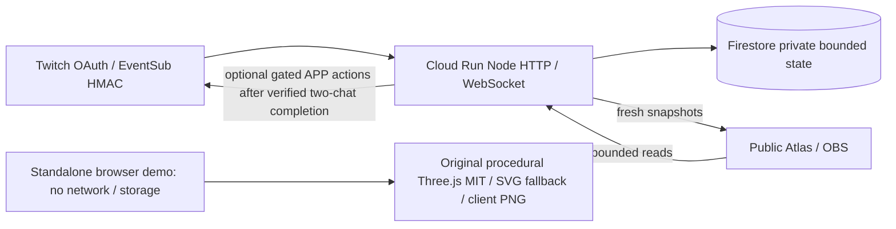
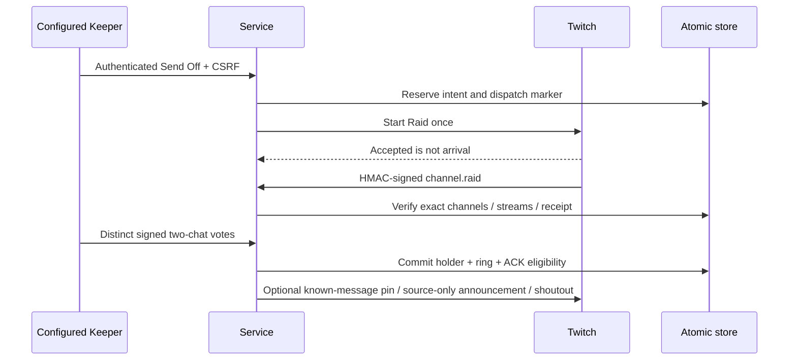

# Architecture and trust boundaries

One Node.js 22 service serves public assets, bounded JSON reads, signed webhooks and WebSockets. Firestore holds the single relic registry, bounded lineage, encrypted OAuth grants, hash-only sessions and optional at-most-once outboxes. There is no general public user index, background clipper or AI provider enabled by default.

## Threat model

Treat raw chat, URLs and provider errors as untrusted. Verify the original UTF-8 webhook body, HMAC, timestamp and event dedupe. Immutable channel identity and stream identity constrain authority; no client-supplied context opens a claim. Accepted Send Off can collect eligible provisional votes, but never grants ownership or animation arrival. Completion requires a matching signed raid, distinct eligible roles, current consent and the receipt-based 180-second window. Presence is source-chat evidence, not actual raid membership. Retired-source proof is limited to the exact signed raid/stream/offline boundary with no newer stream.

OAuth state is one-use, cookie-bound and short-lived; exact client/subject/scopes are checked before encrypted storage. Keeper controls require same-origin session, CSRF and a configured room. Moderator commands require signed broadcaster/moderator authority in that room. No new scopes are requested silently. Optional P7 uses APP actions only after independently verified bot grants and moderator membership; announcements force source-only Shared Chat behavior.

Pending mark text is private. Only approved projections reach public HTTP/socket/Atlas. Explicit score consent is separate from marks and reading; forget/block/veto/withdrawal purge retained content and associations without refunding abuse counters. Downloads already saved by viewers cannot be recalled. Reply/outbox bounds and dedupe prevent spam amplification. Mark dispatching before external work; unknown/timeout outcomes are never blindly retried. Reconnect is a quiet fresh read, not permission to replay a completed effect. Public GETs do not create claims, grants or jobs.

## Cost and resource boundaries

| Existing resource | Boundary / qualification |
|---|---|
| Cloud Run | 1 CPU, 256 MiB, min 0 / max 1, request-throttled CPU, startup boost off; active HTTP/WebSocket requests can bill |
| Firestore | Existing database; atomic bounded documents, 16 retained stops, 160 marks, public pagination; quota/free-tier limits still apply |
| Artifact Registry | 0.5 GB allowance; operator baseline approximately 350 MB, not a new measurement; automatic cleanup remains dry-run |
| Browser graphics | One procedural relic, bounded particles/sprites, original SVG fallback; tiny widget 10 idle / 24 arrival FPS, full 30 / 60, corner 30 |
| AI / clips | Disabled; clips double-OFF and not runtime-wired; no new paid APIs, services or server renderer |

These limits reduce exposure; they do not guarantee a zero invoice. Existing operations/pins/checker stay unchanged. See [operator history](docs/ops/DELIVERY_HISTORY.md) and [permission reasons](docs/JUDGE_SCOPES.md).
