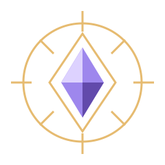

# Raid Relic

Raids that leave a story. A living relic your chat passes to the next stream. Both chats claim it. Every hand-off adds a ring.

[**Open the private review**](https://review-1031---raid-relic-vz4bhnskgq-uc.a.run.app) · [45-second judge cut](https://review-1031---raid-relic-vz4bhnskgq-uc.a.run.app/demo/judge) · [150-second recording film](https://review-1031---raid-relic-vz4bhnskgq-uc.a.run.app/demo/film?autoplay=1&kiosk=1)

Enter the short-lived access code delivered only to the owner by private DM; it is never in this repository or URL. This review is read-only: real Twitch OAuth/control mutations are blocked. The film/judge cut are labelled fiction, with no real transfer; the separate interactive demo lasts35seconds.

*Original procedural/vector art, not a live view, screenshot or verification result.*

An accepted raid request is not an arrival. A verified raid and both eligible chats must claim within the real180-second app window; chat location does not prove raid membership.

Only approved engravings are public. Forgetting erases retained content without refunding quota; saved downloads cannot be recalled. Historical coverage is incomplete, not an all-time leaderboard.

This is a configured pilot, not open public signup. raidrelichq, olsols2 and olsols3 are creator test channels, not evidence of community adoption.

## Run locally

Use **Node.js 22+**: `npm ci && npm test`, then `npm run judges` for the labelled offline/local fixture. Keep credentials outside the repository; see [.env.example](.env.example).

## Read more

[Project guide: setup, permissions, demos, cost and dated history](docs/PROJECT_GUIDE.md) · [Architecture](ARCHITECTURE.md) · [Privacy](docs/PRIVACY.md)

[Provenance: deployed runtime and scoped proof](docs/PROVENANCE.md) · [73-item panel status](docs/PANEL_STATUS.md) · [Generated quality record](docs/QUALITY.md) · [Built with Codex](BUILT_WITH_CODEX.md)

Scale-to-zero and free-tier allowances are not a zero-invoice guarantee. Paid AI is off; clipping is design-only and not runtime-wired. No production promotion is implied.

Unofficial fan project. Not affiliated with Twitch. Season dates imply no attendance. [MIT licence](LICENSE) · [Third-party MIT/OFL notices](THIRD_PARTY_NOTICES.md).
