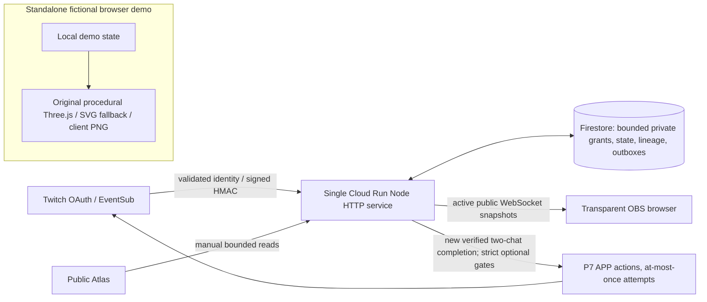

# Raid Relic

An original, evolving relic travels between Twitch communities: a verified raid brings it to the next room, and two chats bind it together. Each completed hand-off adds a gold growth ring and carries approved community runes into a recorded journey. The transparent OBS artwork, Atlas constellation and replay make that shared history visible—without treating chat presence as proof of raid membership.

## Judge in 60 seconds

1. Open the **[P9 review demo](https://p9-review---raid-relic-vz4bhnskgq-uc.a.run.app/demo/)** (operator publishes after final gates). No Twitch login, installation or credentials are needed. Press **Autoplay 35-second tour**.
2. Pause to take over, or Reset → Send Off → offer early → simulate receipt → accept. Tab/Enter operate the controls; reduced motion uses static presentation. A fictional completed binding establishes a holder and unlocks a permanently watermarked **SIMULATED DEMO** PNG; Reset disables downloading again.
3. Open the **[P9 review Atlas](https://p9-review---raid-relic-vz4bhnskgq-uc.a.run.app/atlas/)** (publication pending) for recorded stops, configured Keepers, badges, local replay and per-stop ring cards. Reading never opts a viewer into public scores.

Until publication, the immutable prior [readiness demo](https://readiness---raid-relic-vz4bhnskgq-uc.a.run.app/demo/) and [readiness Atlas](https://readiness---raid-relic-vz4bhnskgq-uc.a.run.app/atlas/) remain available (`raid-relic-ready1026`, source `1a2a1b7`, zero traffic/read-only/P7 OFF). The new planned revision is `raid-relic-p9review1026`, tag `p9-review`; it is not published yet. [Prior P9ee demo](https://p9-stretch---raid-relic-vz4bhnskgq-uc.a.run.app/demo/) and its Atlas remain immutable too.

The permanently labelled demo starts with fictional Keepers and zero rings. It runs only in browser memory: **no API, socket, provider or storage writes** (`connect-src 'none'`). The Atlas is separate and reads retained public records.


**Delivery boundary, parent-reported 26 October:** canonical `raid-relic-judgefix1026` / `6401dcb` remains 100%, P7 five gates ON/pin 300, paid OFF. Published P9 `eeabe365` / tag `p9-stretch` remains **0%, read-only, P7 OFF**; existing P8 previews remain pinned. This readiness increment changes neither deployment. Preview HTTP/demo works; preview self-origin WSS403 is intentional under strict canonical-only origins. Canonical callbacks still run 6401, so a real raid there does **not** validate new P9 code. Promotion needs Grok approval.

## Install for an owner-configured Keeper

Only the two configured Keeper rooms are supported; this is not arbitrary-channel self-service. The owner configures the allowlist, then the matching broadcaster completes OAuth in their own browser. In authenticated private Keeper controls, use **Bootstrap / reconcile this channel**, confirm cached readiness, and **Opt in / Keep**. The operator handles configuration and optional bot permissions; no judge credentials are required. [Owner safety/history](docs/LIVE_TEST.md) · [private bot setup](docs/P7_RULES.md).

In OBS, add a **Browser Source** using the public canonical Home URL:

```text
https://raid-relic-760724762396.us-central1.run.app/overlay/1591805230
```

Use 1280×720, or append `?corner=1` for 160×160. Hidden sources and sources idle for ten minutes without human interaction pause and close their socket; focus/interact or hide/show to resume with a fresh, quiet snapshot. Do not assume an unattended OBS source stays connected forever. Close unused sources; active WebSocket requests can be billable.

A real transfer requires a verified Twitch raid and distinct eligible votes from both chats. Send Off acceptance is not arrival; verified landing opens 180 seconds. Marks have **five-per-viewer/per-stream** quota and 30-second cooldown. Manual review is the default; optional local rules auto-approve clean valid new marks and hold custom matches privately, while hard-unsafe input is rejected. Forget/block/veto/opt-out purge retained associations without refunding quotas; bounded abuse/dedupe hashes remain briefly. Saved downloads cannot be recalled. Ban-reconciliation preparation remains unwired.

## Permissions: what and why

| Consent | Exact scopes | Purpose |
| --- | --- | --- |
| Keeper baseline | `channel:bot`, `channel:manage:raids` | Permit the configured bot in the room; make one explicit authorized Send Off request. |
| Bot baseline | `user:read:chat`, `user:write:chat`, `user:bot` | Receive signed chat events and send bounded bot replies as that bot. |
| Optional bot P7 | `moderator:manage:announcements` | Source-only APP announcements after a newly completed verified binding. |
| Optional bot P7 | `moderator:manage:chat_messages` | Pin the already-sent completion message; replacing an existing pin requires explicit operator acknowledgment. |
| Optional bot P7 | `moderator:manage:shoutouts` | Shout out the outgoing configured Keeper from the new Keeper's room. |
| Optional bot P7 | `user:read:moderated_channels` | Verify that the bot moderates both configured rooms; discard unrelated rooms. |
| Future clip consent, **not implemented/active** | `clips:edit` | Proposed bot USER-token clip creation; preserve its existing seven permissions, giving eight total only after explicit future consent. |

Optional consent never switches server gates. Source defaults keep all five P7 gates and paid gates OFF; the operator separately enabled P7 in current production. P9 clips remain double-OFF **and not runtime-wired**: no consent URL, production transport, ledger or automatic confirmation loop. HTTP202 would mean request accepted, not clip created. [P9 coverage, review and clip timing/privacy rules](docs/P9_RULES.md).

## How it works



Untrusted text never supplies identity, approval or game authority. There is no public viewer-ID index, background provider polling, server PNG renderer or live clipper. Existing hosting uses scale-to-zero/min0/max1 and Firestore; no new service or paid model API is added. The project budget and low-cost design are **not a free-tier guarantee**. [Architecture and review checklist](docs/SUBMISSION_READINESS.md).

## How built with Codex

All original app code and docs were authored in the single original session **`01a1705c-a87d-7143-80f6-021e47b78ced`**. Codex wrote source/tests; the parent independently reviews, runs native QA, commits and operates cloud releases. Grok/Olly own physical Twitch and visual review. No Codex provider/live Twitch actions are claimed.

| Phase | Source contribution |
| --- | --- |
| P1 | Native Send Off, signed raid receipt, early-offer continuity and atomic two-chat binding. |
| P2 | Original procedural3D crystal, reviewed local Three.js MIT vendor and SVG fallback. |
| P3 | Receipt-seeking arrival, approved-word flight, bounded impact and single completion fusion. |
| P4 | Relic voice, self-hosted Cinzel OFL font, recovery and bounded private Keeper sessions. |
| P5 | Evidence-derived Keeper ledger and separately consented forward-only raider scores. |
| P6 | Configured-channel constellation, local replay, stop links and transparent embed. |
| P7 | Explicit optional bot consent and gated APP announcement/known-message pin/shoutout attempts. |
| P8 | Cosmetic edition of the same relic and an evidence-derived badge, distinct from official event-day rules. |
| P9 | Client ring cards, forward-only gated streaks, local review/veto, and **unwired clip design only**. |

Reviews caught seconds-versus-milliseconds guards, swallowed4xx diagnostics, an unused chat sender, zero-opacity fusion and a vendor inline canvas style covering its SVG fallback. Grok/Olly reported physical P5 success; that is not proof of all newer features. [Curated Codex account](docs/CODEX_USAGE.md) · [session/evidence limits](CODEX_SESSION.md).

**Parent-verified prior readiness baseline:** 701/701 tests, zero skips; all 30 serial browser workflows/97 checks; 54 served-response SHA matches; three viewed labelled accessibility images and unchanged OAuth metadata (zero fields read). Earlier P9ee had 685/685 tests and 29 workflows/94 checks; both are historical, not candidate159 results.

**Current candidate160, parent-reported:** 706/706 tests with zero skips, both adapter OlsOls2 command regressions passed, and the initial three review checks/three labelled simulated images passed and were viewed good. The **real fifteen-minute wall-clock soak** now passed on this unchanged runtime: 900383 ms, 25 natural tours, two warm-ups, 20 reuse stress cycles and 27 samples. Retained heap grew 244792 B with OLS 13658.79 B/min (<16384); DOM 284/listeners 54 remained constant and all socket/API/storage/provider/error counters were zero. The reported GPU CPU was 121.51 s (renderer 111.29 s/browser 3.03 s); inherited CPU120 was unchanged, with no waiver. This is the reported diagnostic value, not a claim that GPU CPU was below 120. All hard run gates passed. The final repeat review and all 31 serial workflows are still pending, as is publication of the separate zero-traffic P9 review preview. These are local browser proofs, not physical Twitch effects. [Judge guide](docs/JUDGES_QUICKSTART.md).

## Local development and what's next

Node.js 22+: `npm ci`, `npm test`, `npm run judges`; open **http://127.0.0.1:5191/demo**, then Ctrl-C to stop. `/judges` is a separate labelled server-memory fixture, never production Simulator mode. Use only [public configuration placeholders](.env.example); keep secrets outside the repository. [MIT project licence](LICENSE) · [bundled third-party notices](THIRD_PARTY_NOTICES.md).

Next: multiple **simultaneous** relics would require new authority, isolation and quota design; they are not implemented. Optional clipping needs explicit bot consent/privacy approval and separately reviewed transport, persistence and runtime wiring. A clip's roughly 90-second capture/default last 30 seconds cannot guarantee the entire 20-second OBS arrival; waiting for a 180-second binding may miss it, and the broadcaster must include OBS artwork in the actual stream.

Freeze: **31 October 2026, 18:00 UK/UTC**. J5's pinned read-only daily checker and J6's protected baseline/cleanup remain operator-owned and unchanged; [operator history](docs/JUDGE_TRACK_PLAN.md). No new scheduler, cleanup, judging pin, Main merge or promotion is authorized here. Olly/Grok own submission, invitations and footage; no video or Highlight links are invented.

The new [eight-point P9 review](docs/P9_REVIEW_POINTS.md) is candidate source only: fictional streak/moderation, holder-gated cards, exact per-stop filenames, one primary Replay action and a frozen completed 3D relic. Its current unchanged runtime has the parent-reported 900383 ms real-soak pass; final serial browser gates and publication remain pending. No live command fix or physical validation is claimed.
