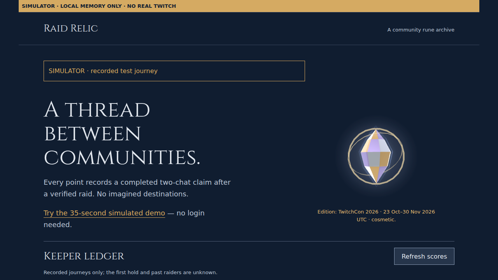
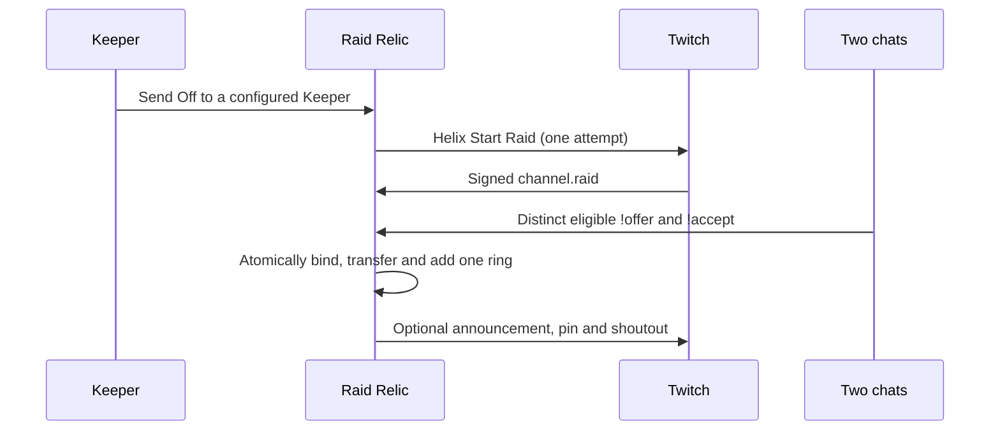

# Raid Relic

A raid usually lasts ten seconds. Raid Relic turns it into something two communities build together, then pass on.



[Try the demo](https://raid-relic-760724762396.us-central1.run.app/demo/) · [Explore the Atlas](https://raid-relic-760724762396.us-central1.run.app/atlas/)

## Judge in 60 seconds

1. Open the demo: no login or installation. Choose **Autoplay 35-second tour**, or use the keyboard to send an offer and accept. Pause, take over, or replay. Reduced motion keeps a readable static relic.
2. Open the Atlas and replay **Stop 8** in the recorded journey. Each completed hand-off adds a ring; retained stops have downloadable ring cards.
3. Imagine this on your stream: viewers leave approved marks on a shared relic, meet the next community, and see the journey continue instead of disappearing when the raid ends.

The demo is browser-only: no Twitch connection, API, socket, persistent storage or game effects. Its downloads are permanently marked simulated. The hero above is a simulated screenshot, not live-stream footage.

## How it works



An accepted Send Off is not an arrival. Watch the claim meter: eligible early offers may be retained; resend after arrival if yours was not counted. Only a signed raid and both eligible chats can complete a binding, within the 180-second arrival window. Chat participation does not prove actual raid membership.

## Verified live

Operator-reported physical review, **26 October 2026, approximately 09:15 UK (UTC)**:

| Journey | Reported result |
|---|---|
| olsols2 → raidrelichq | Ring 8, tracked streak 1; arrival and two-chat binding completed |
| Community hand-off | Announcement, pin and shoutout/follow card appeared; no duplicate effects reported |
| Recorded journey | Stop 8 and replay worked; `!relic top` and `!relic badges` replied correctly |

The author did not independently observe this stream. A separate operator read confirmed the pin request used bot **raidrelicbot** (1591804828), HTTP 204 and a 300-second duration at 09:15:44.959506 UTC. Twitch's differing “raidrelichqbot” UI attribution remains unexplained. The newer own-score and veto-outcome replies have local test coverage, not a new physical review.

## Install on a stream

The owner must first configure your channel as an allowed Keeper; this is not open self-service onboarding. In your own signed-in browser, complete the private Keeper setup and explicit broadcaster OAuth consent, then bootstrap and opt in using the existing owner controls. Bot consent is separate. [Setup and permission reasons](docs/JUDGE_SCOPES.md).

Add an OBS **Browser Source** using the public overlay for your configured channel. Example for raidrelichq:

```text
https://raid-relic-760724762396.us-central1.run.app/overlay/1591805230
```

Hidden sources disconnect immediately. Browser previews and OBS sources pause after ten minutes without human interaction; focus/interact or hide/show to reconnect. Reconnection reads fresh state quietly rather than replaying an old arrival. Close unused sources. Active WebSockets can incur hosting usage.

## Run locally

Use **Node.js 22+** (`.nvmrc`), then:

```sh
npm ci && npm test
npm run judges
```

Open http://127.0.0.1:5191/demo/ and stop with Ctrl-C. The separate `/judges` fixture is local-only, visibly simulated and never a production mode. Keep credentials outside the repository; [.env.example](.env.example) contains configuration examples.

[](https://github.com/OlsOls2/raid-relic/actions/workflows/ci.yml?query=branch%3Afeature%2Fraid-relic-p9-stretch) runs Node 22 tests and formatting without Twitch credentials or deployment permissions. [Quality record](docs/QUALITY.md) is the single authority for dated test results; it distinguishes observed results from pending checks. [Architecture and threat model](ARCHITECTURE.md) · [Built with Codex](BUILT_WITH_CODEX.md) · [Privacy](docs/PRIVACY.md).

## Limits, cost and what's next

One relic travels between configured Keepers. Scores require explicit consent and cover retained, observed completions; earlier streak history is unknown. Marks are limited to five per viewer per stream with a 30-second cooldown. Local review rules can approve valid clean marks or hold flagged marks privately; hard-unsafe text is rejected. Forgetting removes retained content and associations without refunding quota. Saved downloads cannot be recalled.

Existing hosting uses scale-to-zero Cloud Run and bounded Firestore data. No new paid API or AI service is required; free-tier allowances are not a zero-invoice guarantee. AI features are disabled. Clipping remains design-only, double-disabled and not runtime-wired: future bot `clips:edit` consent, privacy approval and reviewed implementation are required. A roughly 90-second clip window/default last 30 seconds cannot guarantee a full arrival, especially after a 180-second claim; the broadcaster must include the OBS relic in the video.

Multiple **simultaneous** relics are future work requiring separate authority, isolation and quotas—not a current feature.

Unofficial fan edition; not affiliated with or endorsed by Twitch/TwitchCon. Cosmetic edition dates do not imply conference attendance. [MIT licence](LICENSE) · [Three.js MIT and Cinzel OFL notices](THIRD_PARTY_NOTICES.md).

The receiving-value pilot source adds an opt-in Seeker queue, a prominent current-Keeper
spotlight and recorded Keeper pages with two share-card orientations. It is awaiting
separate native verification and is not a new live deployment. See the
[receiving-value contract](docs/RECEIVING_VALUE.md) for consent, eligibility and privacy.

Auto-wander source is also under review: an explicitly enabled idle policy can warn a
Keeper, then pass unused ownership to an opted-in eligible Seeker. This is a typed
**non-raid** transfer, not a raid, audience transfer or two-chat claim. It is off by
default, adds no provider scope and needs a separately installed operator worker.
See [Auto-wander](docs/WANDER.md) for the 72-hour / 12-hour policy and limits.

### Configuring a third Keeper

The operator-only `PILOT_KEEPERS_JSON` source path supports up to four configured Keepers; unset preserves the existing two. [Third Keeper setup](docs/THIRD_KEEPER.md) documents olsols3 admission, the exact app OAuth start route, canonical promotion-before-consent order, bot moderation, bootstrap and optional broadcasting. This source is awaiting native QA and owner review; it does not claim third-channel consent, live subscriptions or a published third-network candidate.
