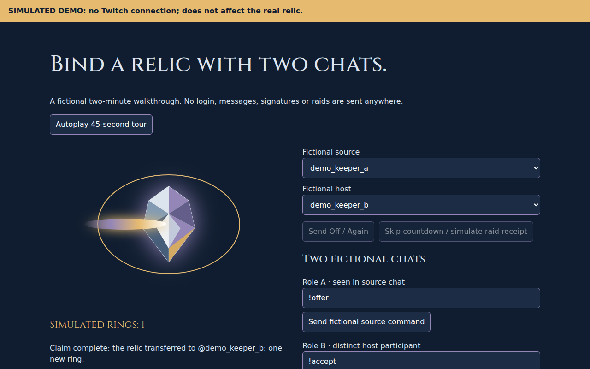

# Raid Relic

> **26 October operator update:** Olly authorized live P7 activation. Parent reports read-only validation of the bot's exact identity/client, all seven scopes and moderator membership in both Keeper rooms at 00:24:22 UTC. Parent verified the configuration-only `raid-relic-p7live1026` revision at 100% at 00:27:44 UTC, using the same b23 image (digest prefix `1a9a9cf`). All five P7 flags are true, pin duration is 300 seconds and replacement acknowledgement is explicit. Parent reports 40 staged and 40 canonical responses byte-matched, with SecretRefs, caps, service account, origins and callbacks unchanged; judge ff56 remains zero traffic. No real chat, announcement, pin, shoutout or raid POST was performed by parent; Grok's live action test remains pending. This judge-track UX is candidate-only, not production source. Source defaults remain OFF; no new physical P7 claim/action proof is asserted.


One original relic, carried between Twitch communities and bound by two chats.



## Judge in three minutes

1. **[Try the judge-track demo](https://judge-track---raid-relic-vz4bhnskgq-uc.a.run.app/demo/)** on the candidate preview (parent publishing; deployment proof pending), or locally at **http://127.0.0.1:5191/demo** after `npm ci` and `npm run judges`. Its permanent banner says **SIMULATED DEMO: no Twitch connection; does not affect the real relic.** Send Off, offer early, skip the fictional countdown and accept from the other fictional chat. No login, credentials or real messages. Canonical b23 `/demo` remains 404 until Grok accepts a future promotion.
2. **See the [actual Atlas](https://raid-relic-760724762396.us-central1.run.app/atlas/)**: retained completed stops, Keeper ledger, approved-text search and local journey replay. Empty/waiting state is honest; no invented destinations or personal ownership inferred from a name. [Recap](https://raid-relic-760724762396.us-central1.run.app/recap) exports a local snapshot; [Forge](https://raid-relic-760724762396.us-central1.run.app/forge) is a template preview, not live customization.
3. **OBS/public view:** [Home](https://raid-relic-760724762396.us-central1.run.app/overlay/1591805230), [Ols](https://raid-relic-760724762396.us-central1.run.app/overlay/1591806023), normally1280×720; append `?corner=1` for160×160. Waiting does not imply a raid. Judge-track overlays close when hidden or after ten minutes without human interaction; focus/interact to resume. Close unused sources. Active WebSockets can be billable; free-tier costs are not guaranteed.

**Judge-track behavior (pending canonical promotion):** in a configured consenting chat, `!relic top`, `!relic badges` and `!relic help` read public information, including offline/nonholder rooms. Status replies are budgeted. `!relic scores on` explicitly shares your name for future completed participation; `!relic scores off` withdraws it. `!relic mymarks` shares a short-lived public link to your own approved retained history. Reading never opts you in. Private owner controls/OAuth are not judge credentials; [owner live workflow](docs/LIVE_TEST.md).

The real ritual still needs a verified Twitch raid and two distinct eligible chat participants. API acceptance only gathers votes; a verified landing opens180seconds. Marks are pending until moderator approval, five per viewer per stream with a30-second cooldown. Forget/block/veto/opt-out erase retained associated content without refunding quotas; minimal bounded anti-abuse/idempotency hashes remain briefly. Saved exports cannot be recalled.

## Built with Codex

All original app code/docs were authored in original session `01a1705c-a87d-7143-80f6-021e47b78ced`; the parent reviews, commits, independently tests and operates deployments. Reviews caught second-versus-millisecond restart watermarks, swallowed raid4xx diagnostics, a defined-but-unused chat sender and a zero-opacity fusion parent. Parent P7 baseline: **613/613 tests, zero skips;23 local browser flows/80 checks**. Parent final QA verified **627/627 tests, zero skips; all 24 local browser workflows/83 checks**, with three reviewed simulated captures. Grok/Olly reported the actual25October21:53–21:57UK Ols→Home P5 test: holderHome/six rings, score consent, early offer, completion and ledger observed. That is not a physical P7 moderation or new-build validation claim. [Factual draft](docs/CODEX_USAGE.md) · [session/export limits](CODEX_SESSION.md).

```
Twitch signed webhook → Cloud Run → atomic Firestore holder/claims/marks/history
                                  → bounded chat outboxes + active OBS WebSockets
Atlas → manual bounded reads; /demo → fictional browser memory only
```

`npm test` runs mocked tests. `scripts/browser-smoke-*.js` use local5191 and sandboxed Chromium; no real Twitch. `npm run judges` serves explicitly labelled local memory fixtures at **http://127.0.0.1:5191/judges**; `/judges` is not deployed. Stop with Ctrl-C. No YouTube/highlight URL is available here; owner footage/submission/access arrangements belong to Olly/Grok.

All five P7 action flags and both paid generation gates remain **OFF**. Optional P7 requires human bot consent, actual moderator roles in both rooms, operator gates and pin-replacement acknowledgement. [P7 activation](docs/P7_RULES.md). Ban-reconciliation foundation remains unwired. No paid API, service or default OAuth scope is added by the judge track. Original SVG/Three MIT and self-hosted Cinzel OFL notices remain included.

[P6 replay rules](docs/P6_REPLAY.md) · [judge-track plan and future operator gates](docs/JUDGE_TRACK_PLAN.md) · [historical README](docs/archive/README-pre-p4.md). P8/P9 remain in scope awaiting concrete definitions; no speculative implementation or dropped scope. Freeze31October2026 18:00UK/UTC.

Operator status (parent-reported, 26 October): [retention policy](ops/artifact-cleanup-dry-run.json) applied **dry-run only**, no images deleted or active cleanup; judging pin remains pending. [Daily checker](docs/DAILY_CHECK.md) is prepared, **not scheduled or auth-wired**. Parent default-branch fast-forward waits for full QA and zero-traffic preview parity; canonical promotion still requires Grok acceptance.
