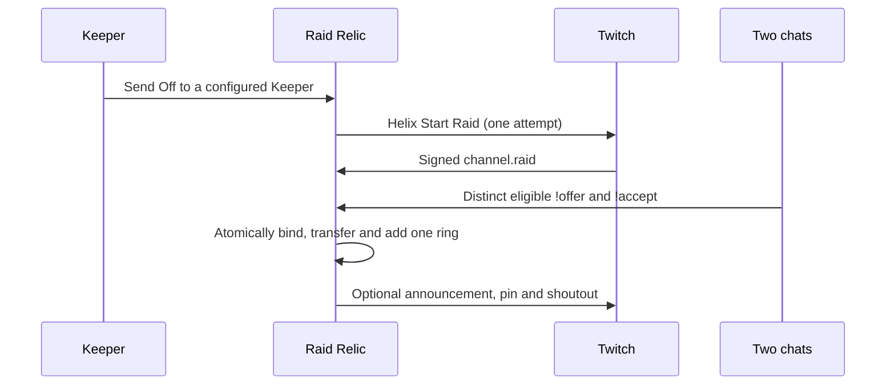

# Project guide · retained README detail

Updated 30 October 2026. This guide preserves the longer README, including dated historical reports and limits. The single current release/proof ledger is [PROVENANCE](PROVENANCE.md): published film-clock source and LOCAL UNPUBLISHED Groups 3–5 are distinct. Old counts below belong only to their named cohorts. No production promotion is inferred.

A raid usually lasts ten seconds. Raid Relic turns it into something two communities build together, then pass on.

[**Try the whole loop in 45 seconds — no Twitch login**](https://film-clock-1030---raid-relic-vz4bhnskgq-uc.a.run.app/demo/judge)

This read-only review sandbox plays Send Off → arrival → two-chat claim → approved engraving → fictional live-holder spotlight → journey/replay → ring-card preview. Everything is local sample fiction, with no Twitch connection, API, socket, storage or real transfers. Pause, skip or restart; a permanently simulated PNG downloads only when you choose **Export simulated ring card**. This is a review preview, not a production promotion.

Historical checkpoint — as of 27 October 2026, the operator reported the earlier four requested review increments complete: [scoped security](SECURITY.md), [accessibility and a real two-hour active-use soak](ACCESSIBILITY_PERFORMANCE.md), the no-login judge sandbox, and [hosted full-runtime journey CI](CI_JOURNEY.md). Accepted native coverage is 913/913 tests with zero skips and 44 serial browser workflows / 137 checks; [both hosted jobs passed](https://github.com/OlsOls2/raid-relic/actions/runs/40516037721) for runtime `57f005d`. These are synthetic fixture results, not physical Twitch/OBS certification.

## Judge in 60 seconds

1. Open the **45-second whole-loop sandbox** above. Watch the provisional offer wait for a distinct simulated accept before the one recorded ring appears. No account or installation is needed.
2. At the last scene, optionally export the simulated card. Reduced motion keeps a readable SVG relic; focused controls retain their normal keys.
3. For recording, use the [published 150-second fictional film](https://film-clock-1030---raid-relic-vz4bhnskgq-uc.a.run.app/demo/film?autoplay=1&kiosk=1). The [35-second interactive demo](https://raid-relic-760724762396.us-central1.run.app/demo/) remains available for hands-on votes: choose **Autoplay 35-second tour** there; the [Atlas](https://raid-relic-760724762396.us-central1.run.app/atlas/) shows the separately retained public journey.

[Judge guide and evidence boundaries](JUDGES.md). The ARCHIVE filenames below refer to historical viewport views of the labelled `/demo/film` simulator, not live Twitch or physical OBS footage. They contain obsolete branding and are not rendered as current art. The parent operator captured, viewed and promoted both native source233 PNGs; their source route and simulated sample labels remain explicit.

ARCHIVE file: `docs/media/demo-film-story.png` — source233, 27 October 2026; historical simulated relic and fictional Keeper spotlight. See [archive metadata](SCREENSHOTS.md).

*SIMULATED `/demo/film`, spotlight scene; fictional Keepers, one sample ring. 1280×720 viewport, not full-document coverage.*

ARCHIVE file: `docs/media/demo-film-card.png` — source233, 27 October 2026; historical simulated ring-card preview, sample engraving and fictional journey. See [archive metadata](SCREENSHOTS.md).

*SIMULATED `/demo/film`, manual-export preview; not a live card or evidence of a real transfer. 1280×720 viewport; export is optional.*

## How it works



An accepted Send Off is not an arrival. Watch the claim meter: eligible early offers may be retained; resend after arrival if yours was not counted. Only a signed raid and both eligible chats can complete a binding, within the 180-second arrival window. Chat participation does not prove actual raid membership.

## Historical owner test-channel observations · 26 October 2026

Operator-reported physical review, **26 October 2026, approximately 09:15 UK (UTC)**:

| Journey               | Reported result                                                                    |
| --------------------- | ---------------------------------------------------------------------------------- |
| olsols2 → raidrelichq | Ring 8, tracked streak 1; arrival and two-chat binding completed                   |
| Creator test hand-off    | Announcement, pin and shoutout/follow card appeared; no duplicate effects reported |
| Recorded journey      | Stop 8 and replay worked; `!relic top` and `!relic badges` replied correctly       |

These were creator test channels, not community adoption, launch traction or real-user growth. The author did not independently observe this stream. A separate operator read confirmed the pin request used bot **raidrelicbot** (1591804828), HTTP 204 and a 300-second duration at 09:15:44.959506 UTC. Twitch's differing “raidrelichqbot” UI attribution remains unexplained. Later owner-reported olsols2 → olsols3 feedback reached Ring 10 / Streak 3 on 26 October, with retained state independently read by the operator at 22:47 UTC. This is owner physical feedback, not source-author observation.

## Install on a stream

The owner must first configure your channel as an allowed Keeper; this is not open self-service onboarding. In your own signed-in browser, complete the private Keeper setup and explicit broadcaster OAuth consent, then bootstrap and opt in using the existing owner controls. Bot consent is separate. [Setup and permission reasons](JUDGE_SCOPES.md).

Add an OBS **Browser Source** using the public overlay for your configured channel. Example for raidrelichq:

```text
https://raid-relic-760724762396.us-central1.run.app/overlay/1591805230
```

Historical published browser behavior used hidden-stop and ten-minute human-idle suspension. LOCAL UNPUBLISHED Group 3 separates OBS (`obsstudio` user agent or `obs=1`) read retention from ordinary browser/control idle behavior; it does not authorize game actions or certify physical OBS. Its parent-run one-hour result covers the frozen source274 default-card workload and synthetic read projection, not the final current tree. Reconnection reads fresh state quietly rather than replaying an old arrival. Close unused sources. Active WebSockets can incur hosting usage. [Current scope and limits](PROVENANCE.md).

## Run locally

Use **Node.js 22+** (`.nvmrc`), then:

```sh
npm ci && npm test
npm run judges
```

Open http://127.0.0.1:5191/demo/ and stop with Ctrl-C. The separate `/judges` fixture is local-only, visibly simulated and never a production mode. Keep credentials outside the repository; [.env.example](../.env.example) contains configuration examples.

[](https://github.com/OlsOls2/raid-relic/actions/workflows/ci.yml?query=branch%3Afeature%2Fraid-relic-p9-stretch) runs Node 22 tests, formatting and the isolated headless runtime journey without Twitch credentials or deployment permissions. [Quality record](QUALITY.md) is the single authority for dated test results; it distinguishes observed results from pending checks. [Architecture and threat model](../ARCHITECTURE.md) · [Built with Codex](../BUILT_WITH_CODEX.md) · [Privacy](PRIVACY.md).

## Limits, cost and what's next

One relic travels between configured Keepers. Scores require explicit consent and cover retained, observed completions; earlier streak history is unknown. Marks are limited to five per viewer per stream with a 30-second cooldown. Local review rules can approve valid clean marks or hold flagged marks privately; hard-unsafe text is rejected. Forgetting removes retained content and associations without refunding quota. Saved downloads cannot be recalled.

Existing hosting uses scale-to-zero Cloud Run and bounded Firestore data. No new paid API or AI service is required; free-tier allowances are not a zero-invoice guarantee. AI features are disabled. Clipping remains design-only, double-disabled and not runtime-wired: future bot `clips:edit` consent, privacy approval and reviewed implementation are required. A roughly 90-second clip window/default last 30 seconds cannot guarantee a full arrival, especially after a 180-second claim; the broadcaster must include the OBS relic in the video.

Multiple **simultaneous** relics are future work requiring separate authority, isolation and quotas—not a current feature.

Unofficial fan project. Not affiliated with Twitch. Cosmetic season dates do not imply event attendance. [MIT licence](../LICENSE) · [Three.js MIT and Cinzel OFL notices](../THIRD_PARTY_NOTICES.md).

The receiving-value pilot source adds an opt-in Seeker queue, a prominent current-Keeper
spotlight and recorded Keeper pages with two share-card orientations. These features
are included in the published read-only recording preview below. See the
[receiving-value contract](RECEIVING_VALUE.md) for consent, eligibility and privacy.

Auto-wander is a separately gated feature: an explicitly enabled idle policy can warn a
Keeper, then pass unused ownership to an opted-in eligible Seeker. This is a typed
**non-raid** transfer, not a raid, audience transfer or two-chat claim. It is off by
default and adds no provider scope. The installed operator worker remains commented
out pending explicit owner GO.
See [Auto-wander](WANDER.md) for the 72-hour / 12-hour policy and limits.

### Configuring a third Keeper

The operator-only `PILOT_KEEPERS_JSON` path supports up to four configured Keepers; unset preserves the existing two. The parent reported the canonical three-Keeper mapping, including olsols3; the creator test channels are raidrelichq, olsols2 and olsols3. This is not open public signup or evidence of adoption. [Third Keeper setup](THIRD_KEEPER.md) documents the exact app OAuth route, bot moderation, bootstrap and optional broadcasting. This job did not observe third-channel consent, moderation, bootstrap, Keep, Seeking or OBS setup; those remain owner actions through the canonical service, not the read-only preview.

### Historical read-only card review and archive metadata

The historical published [holder-card preview](https://holder-card---raid-relic-vz4bhnskgq-uc.a.run.app/atlas/) adds approved engravings, retained journey/hops and separate **Keeper at this stop** / **Current holder at export** labels to the existing manual PNG downloads. Try the Atlas and [Keeper page](https://holder-card---raid-relic-vz4bhnskgq-uc.a.run.app/keeper/olsols3), or the [local simulated tour](https://holder-card---raid-relic-vz4bhnskgq-uc.a.run.app/demo/). No login or live action is needed. [Card review steps](JUDGES_QUICKSTART.md) · [Dated preview screenshot gallery](SCREENSHOTS.md).

ARCHIVE file: `docs/media/atlas-preview.png` — captured 27 October 2026 at 02:57 UTC; recorded Ring 10 is a dated snapshot with obsolete branding. The file is unchanged and not rendered here. [Archive metadata](SCREENSHOTS.md).

The operator reports **838/838 native tests, zero skips, and 38 serial browser workflows / 119 checks**, plus three decoded synthetic-fixture card PNGs actually viewed. This cohort validates runtime `4640d0fc17cd8e3b8806ec243e119642e2098dcb`, revision `raid-relic-holder-card-1027`, tag `holder-card` at zero traffic, published at 02:55:45 UTC on 27 October 2026. [Successful CI](https://github.com/OlsOls2/raid-relic/actions/runs/40441046599) · [Report-derived quality record](QUALITY.md). These are native synthetic/browser results, not physical Twitch or OBS signoff. This is the historical holder-card cohort; the later accepted application cohort is recorded above.

At that historical pre-release observation, production was `raid-relic-seeker-state-on-1026` / `3d` at 100%. At the later staging observation on 27 October, the parent instead found externally created `raid-relic-eventsub-fix-on-1027` / `d2ae612945a40bee51a3c879d94bcf68cf8f9fc8` at 100%, created at 13:15:14.573404 UTC. This run did not create or promote it; its acting principal and approval are not established here, and no rollback is inferred. Production allocation is mutable. The preview is master read-only, all five P7 action gates OFF, Seekers ON, Wander/clipping/paid features OFF. OAuth/control mutations are denied by design; this release performs no promotion or live activation. Wander scheduling remains commented out until explicit Olly/Grok GO.

### Seeker choice and authorization maintenance

The published source includes Seeker-first suggestions while allowing other ready, live, opted-in configured Keepers as manual targets. Completed recipients leave the queue; holders are excluded, former holders must explicitly rejoin after passing, and `!seek status` reports observed membership/rank without joining. [Membership policy](SEEKER_MEMBERSHIP.md).

Existing Keeper/bot grants are maintained before use on access-token rejection or within 120 seconds of expiry, using per-role singleflight, distributed leases and atomic encrypted pair rotation. Fresh valid grants need no token-lease writes; cached control status makes no extra provider calls. Transient failures mean retry later; definitive refresh rejection requires reconnecting. The operator recovered all three Keeper grants on 26 October at 22:10 UTC without reconsent; this is a dated result, not a promise that future grants remain valid. [Authorization maintenance](AUTHORIZATION_RECOVERY.md). The source author performed no account recovery or live provider action.

Freeze: **31 October 2026, 18:00 UK/UTC**.

### Film the fictional loop

Source 208 adds a client-only **`/demo/film`** storyboard: 150 seconds from Send Off through arrival, two-chat binding, engraving, simulated Keeper spotlight, journey replay and a manually exported simulated card. Space pauses, Next skips, and Restart resets the local story. It is permanently labelled FILM / SIMULATOR, with no Twitch connection, audio or real transfers. [Film controls and bounded recording handoff](DEMO_FILM.md). The U2 film update was subsequently published as film-clock-1030 at zero traffic on source95635e4. It adds explicit autoplay kiosk mode, elapsed-time catch-up and static normal reduced-motion playback. Use the [published film-clock recording link](https://film-clock-1030---raid-relic-vz4bhnskgq-uc.a.run.app/demo/film?autoplay=1&kiosk=1); dated full proof is in [PROVENANCE](PROVENANCE.md). Historically, the operator published [the older read-only film preview](https://demo-film---raid-relic-vz4bhnskgq-uc.a.run.app/demo/film) from `48f35cbb8f7664a9cd27b5acb9965d6ed2b25874` after its native/capture gate; that earlier cohort does not validate the later onboarding increment below.

### New Keeper checklist

Source 212 adds **`/start`** and a private own-channel checklist for connecting Twitch, opting in, copying the canonical OBS URL and explicitly becoming a Seeker. Historical public readiness started unchecked and private ticks expired after ten seconds. LOCAL UNPUBLISHED Group 5A replaces that client-only expiry with factual checked-age and four tasks; copying/manual acknowledgement still never claims OBS is server-verified. Its authenticated status GET is read-only, visible polling is bounded at 5/30 seconds, hidden polling stops, and only an explicit Setup flow may reconcile. Backend fresh authorization/eligibility checks remain. [Control wizard](CONTROL_WIZARD.md). This remains a configured pilot, not open enrollment. [Two-minute setup guide and review boundaries](GETTING_STARTED.md). The older checklist belonged to its historical preview cohort. The new four-step wizard, front door, overlay and moderator/filter work remain LOCAL UNPUBLISHED; no current whole-tree suite or preview is claimed. Source authoring does not promote production.

### Reliability review layers

[Source 216 reliability review](RELIABILITY_DEMO.md) covers signed webhook redelivery, pending-claim token expiry, shared-store runtime reconstruction and an actual local browser WSS recovery workflow. EventSub uses webhooks; the WebSocket is the read-only OBS/browser feed. The operator corroborated one min-zero cold start on the older `judge-ready` / `9b` zero preview with a matching AUTOSCALING startup record; its 2223ms first GET and 117ms follow-up are an anecdote, not a latency guarantee or a cold test of the new reliability revision. This test/docs increment adds no running resource, keepalive or production behavior change; its local recovery checks are included in the accepted application cohort.

The [headless runtime journey CI gate](CI_JOURNEY.md) exercises local mock OAuth, own controls, signed raid receipt, two-chat binding, public spotlight/replay and decoded PNG export. It is separate from the fictional judge film and owner-operated physical Twitch/OBS review. Both hosted jobs passed for deployed review runtime `57f005dc07ea5ec9540bbcbdd39f69d57f761cf1` ([journey-ci0](https://journey-ci---raid-relic-vz4bhnskgq-uc.a.run.app)). The separate real two-hour active-use soak passed declared bounds; it is never run on every commit. Later docs-only commits preserve that runtime identity.

## Current local working-tree additions · unpublished

Groups 3–5 add the bounded OBS card/verified takeover and isolated local preview, a dedicated front door, current-only formatting/cards, the four-step own-channel control wizard, whole-word input filtering, and signed moderator pending/last/structured-mention review. They are **LOCAL UNPUBLISHED**, not features of the published film-clock runtime. See [front door](FRONTDOOR.md), [control wizard](CONTROL_WIZARD.md), [offline filter](MARK_FILTER.md), [moderator commands](MODERATOR_COMMANDS.md), and [PROVENANCE](PROVENANCE.md) for proof boundaries and remaining work.
