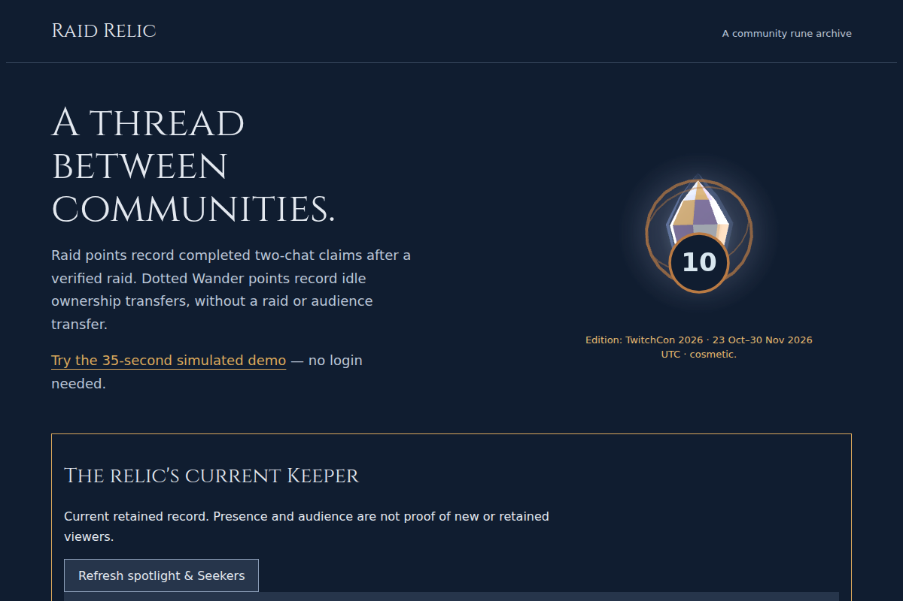
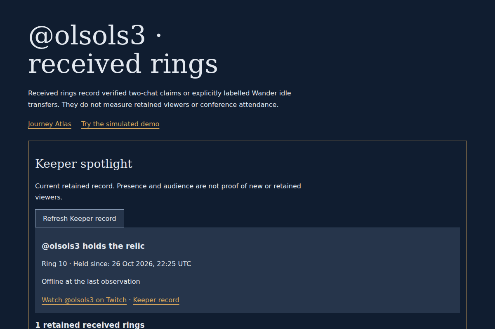
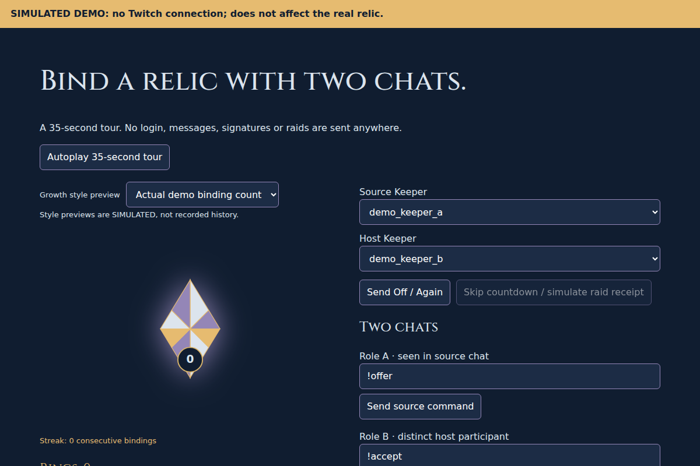

# Read-only preview screenshots — 27 October 2026

The operator captured and actually viewed these three unchanged PNGs at **2026-10-27T02:57:37.192Z**, from [holder-card](https://holder-card---raid-relic-vz4bhnskgq-uc.a.run.app), revision `raid-relic-holder-card-1027`, runtime `4640d0fc17cd8e3b8806ec243e119642e2098dcb`. Each is a **1200×800 viewport crop**, not complete page coverage, canonical-production footage or physical Twitch/OBS proof. Ring/holder/live labels are point-in-time observations, not permanent claims.

The operator used sandboxed Chromium in a PID namespace, same-origin HTTP GET only, no login or cookies, and blocked control/OAuth/internal/EventSub paths, POSTs, third-party traffic and WSS. The run reported zero page errors and zero blocked requests; it performed no chat, Send Off, raid, consent or control action. The source author did not run this capture or alter these images.

## Atlas

[Open Atlas](https://holder-card---raid-relic-vz4bhnskgq-uc.a.run.app/atlas/). The frame shows the original 3D hero and current-Keeper section. Ring 10 is the retained snapshot at capture time. File: 110700 bytes; SHA-256 `6197c17f9e9c2eb7cb8b045f246588066999590fe4a37765779789d12ddc5bd0`.

## Keeper page

[Open Keeper page](https://holder-card---raid-relic-vz4bhnskgq-uc.a.run.app/keeper/olsols3). The capture reports @olsols3 holding the relic and offline at the last observation; it does not prove a currently live stream. File: 81955 bytes; SHA-256 `8e5bf4cb7ab45b04eb1d52b4a028bcb7b530addcda4db701f89c141c96fd14ee`.

## Simulated demo

[Open demo](https://holder-card---raid-relic-vz4bhnskgq-uc.a.run.app/demo/). This is local fiction, permanently labelled SIMULATED, without Twitch connection or effects on the real relic. File: 106847 bytes; SHA-256 `ec75662569176d2e4aaacb8ef5bfb4693d549f434d0d642dbca76c54f7bdc9dd`.

These UI crops do not show an exported card and involved no real-app download click. Separately, the operator decoded and viewed three signed synthetic-fixture card PNGs: Atlas 1200×630, Keeper landscape 1200×675 and vertical 720×1280, each ≤512KiB. Their genuine pixels, approved engravings, current-versus-recorded labels and erasure cancellation were native test evidence, not physical Twitch screenshots. [Review steps](JUDGES_QUICKSTART.md) · [Card contract](SHARE_CARDS.md).

The preview is master read-only with P7 five OFF, Seekers ON, Wander/clip/paid OFF. Scheduling remains commented pending explicit Olly/Grok GO. Existing older images and recording notes retain their own historical provenance; none is silently relabelled as this capture.
